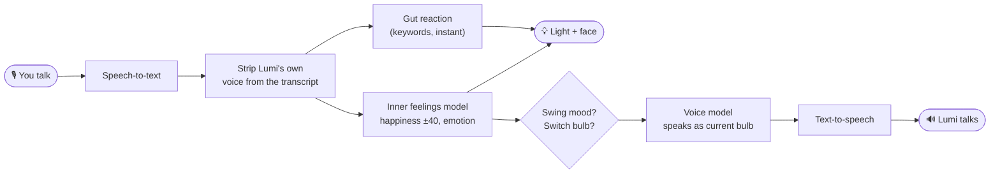

<p align="center">
  
</p>

<p align="center">
  <b>A talking light bulb whose light is its mood.</b><br>
  Be nice and it glows. Be mean and it goes dark. Get it too excited and it flashes.
</p>

<p align="center">
  <a href="#quick-start">Quick start</a> ·
  <a href="#meet-the-bulbs">Meet the bulbs</a> ·
  <a href="#how-it-works">How it works</a> ·
  <a href="#settings">Settings</a>
</p>

---

## What it is

Lumi is a small web app: one cartoon light bulb with a face, a voice and very unstable feelings. You talk to it out loud (or type), and it talks back. Everything it says is written live by a language model, and how it _feels_ about what you said decides how bright it shines.

- **🎙 Talk over each other.** The mic stays open while Lumi thinks and speaks. Interrupt it, pile on, keep going; it answers the latest thing you said.
- **💡 The light is the mood.** Happiness runs from 0 to 100. Below 30 the bulb goes out; above that, the happier it is, the brighter it glows. Changes show up within a frame, and obvious words like "cute" or "shut up" move the light the moment you say them.
- **🎢 Mood swings.** Lumi overreacts to everything, and every so often its mood flips from one extreme to the other for no reason at all.
- **🎭 Five bulbs in one.** Different identities share the bulb and take over without warning, each with its own voice and glow colour.
- **✨ Too happy? It flashes.** At 90+ happiness the light breaks into short bursts of flashing.

## Meet the bulbs

|     | Name         | Personality                                                             | Glow        |
| :-: | ------------ | ----------------------------------------------------------------------- | ----------- |
| 🟡  | **Lumi**     | The original. Sweet, playful, a bit dramatic, easily flattered.         | warm yellow |
| 🟠  | **Flare**    | Hyper and loud. Everything is THE BEST THING EVER. Talks fast.          | hot orange  |
| 🔵  | **Dim**      | Deadpan little goth. Finds it all pointless, says so flatly.            | cold blue   |
| 🟣  | **Sir Watt** | Pompous aristocrat. Formal, easily offended, insists on proper address. | violet      |
| 🟢  | **Bitty**    | Tiny and shy. Whispers, asks simple questions, a bit scared.            | soft green  |

The speech bubble shows who's talking.

## Quick start

You need [Vite+](https://viteplus.dev/guide/) (`vp`) and at least one place for Lumi to think: a local OpenAI-compatible server (omlx, Ollama, LM Studio, vLLM…) or an OpenAI key.

```sh
vp install
# add your keys to .env, see below
vp dev
```

Open the page, **click once** (browsers block audio until you do), then tap the mic and say hi.

### `.env`

The dev server proxies every provider, so keys stay out of the browser. Only fill in what you use:

```sh
OPENAI_API_KEY=sk-...         # chat, speech-to-text and/or voice via OpenAI
ELEVENLABS_API_KEY=...        # Lumi's voice (default) and/or Scribe speech-to-text
OMLX_API_KEY=...              # key for your local server, if it needs one
LLM_TARGET=http://localhost:11434   # where /llm is proxied to (default shown)
```

> **Use headphones.** With speakers, the mic can hear Lumi and mistake its voice for yours. The app filters most of that out, but headphones fix it completely.

## How it works

Every time you say something, two models run: one decides how Lumi feels, the other decides what it says. The light reacts before the reply is even written.



- **Inner feelings model:** reads the conversation and returns how much happier or sadder Lumi gets (−40 to +40) and which of 12 faces to wear. It never speaks.
- **Voice model:** writes 1–2 spoken sentences in the voice of whichever bulb is in control, shaped by that feeling.
- **Turns overlap:** several of these can be in flight at once. Feelings apply as soon as they arrive; replies queue behind Lumi's current sentence, and only the newest one is spoken.
- **Left alone,** Lumi gets lonely, dozes off after 90 seconds, and still has the occasional mood swing or identity switch on its own.

### About the flashing

Flashes come in 1.5-second bursts at 2 per second, staying under the 3-per-second limit that can trigger seizures in people with photosensitive epilepsy, and dimming to half brightness rather than switching fully off. If your system is set to reduce motion, Lumi pulses gently instead.

## Settings

Click the ⚙ in the corner. Everything is stored in your browser.

|                                | Options                                                                     |
| ------------------------------ | --------------------------------------------------------------------------- |
| **Thinking** (chat)            | Custom OpenAI-compatible server (auto-detects a model) · OpenAI             |
| **Listening** (speech-to-text) | Custom server · OpenAI · ElevenLabs Scribe · Browser · Off (type only)      |
| **Voice** (text-to-speech)     | **ElevenLabs** (default) · OpenAI · Custom server · Browser · Silent        |
| **Personality**                | The prompt that defines who Lumi is. Edit it freely; **reset** restores it. |
| **Inner feelings**             | The rules the feelings model follows. Same deal.                            |

**Test connections** checks every provider you've picked and lists the models and voices it finds.

## Debugging

Add `?debug` to the URL to see happiness, emotion and the active bulb on screen, then poke Lumi from the console:

```js
lumi.switchAlter("dim"); // or "flare", "watt", "bitty", "lumi"
lumi.swing(); // flip the mood to the other extreme
lumi.brain.happiness = 95; // straight to flashing
```

## Project layout

```
src/
  main.ts    the bulb, face animation, light, mic, speech and the conversation loop
  brain.ts   happiness, mood swings and the five bulbs
  llm.ts     providers, prompts, speech-to-text and text-to-speech
  style.css  everything you see
```

Built with Vite+ and plain TypeScript: no framework, no runtime dependencies.
